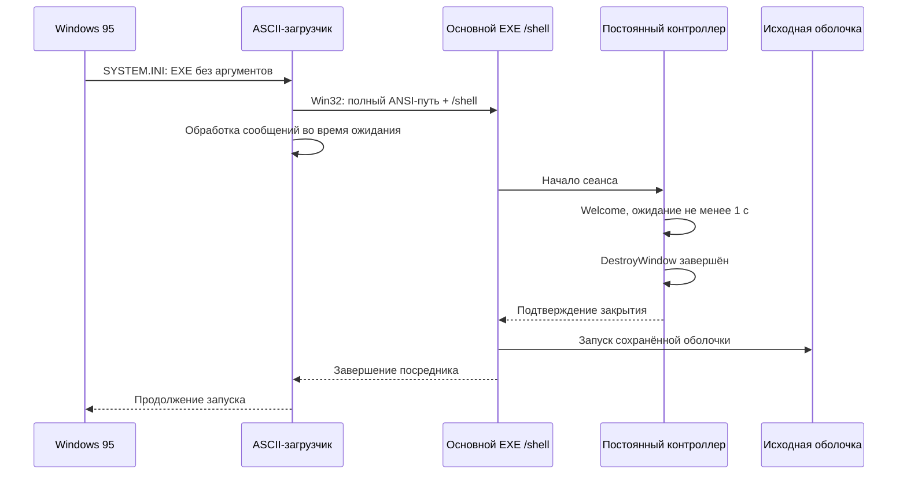

# Запуск оболочки и повторный вход Windows 95

Enable теперь подключает Welcome95 к запуску оболочки. Перед первым изменением
сохраняются исходное значение `[boot] shell` и факт его отсутствия, параметры
оболочки и владелец установки в `HKLM\Software\Welcome95\Startup`.
Дополнительно рядом с EXE создаётся **новый** файл `W95xxxx.BAK` с текстом
`[boot]` / `shell=...`, читаемый из DOS. Старые файлы не перезаписываются.
Основной EXE может находиться в папке с пробелами и кириллицей. Для старого
загрузчика SYSTEM.INI устанавливается отдельный маленький `W95BOOT.EXE`:
`C:\W95xxxx.TMP\W95BOOT.EXE` (диск выбирается по месту установки Windows).
Это новый каталог с ASCII-именем 8.3; существующие файлы не перезаписываются.
Загрузчик встроен в основной EXE и извлекается при Enable. Данные резервной копии
сбрасываются на диск и в реестр до изменения shell.

**Короткий путь сам по себе не гарантирует отсутствие кириллицы.** SYSTEM.INI
теперь содержит только ASCII-имя EXE **без аргументов**. Загрузчик по умолчанию
запускает основной EXE с `/shell` через Win32 CreateProcessA, прочитав его ANSI-путь
из собственного раздела реестра. Поиск файла с кириллическим именем больше не
передаётся старому загрузчику shell. Основной EXE должен оставаться по своему пути.

Изменяются только `[boot] shell` в SYSTEM.INI и значения `Welcome95` в трёх
разделах HKLM `Software\Microsoft\Windows\CurrentVersion`:

| Раздел / настройка | Команда | Назначение |
| --- | --- | --- |
| RunServices | ASCII-загрузчик + `/welcome` | Запуск постоянного контроллера |
| RunOnce | ASCII-загрузчик + `/startup` | Синхронная задержка обычного автозапуска |
| SYSTEM.INI `[boot] shell` | Только ASCII-загрузчик | Win32-переход к основному EXE с `/shell` |
| Run | ASCII-загрузчик + `/session-ready` | Уведомитель logoff текущего сеанса |

RunOnce считается расходуемой записью: её отсутствие после запуска не означает
Disable. Она восстанавливается для следующего входа. Другие Run/RunOnce, службы,
папки автозагрузки и параметры исходной оболочки не удаляются и не переписываются.
Порядок других заданий RunOnce остаётся у Windows. Системные RunServices не
задерживаются. Новая схема начинает действовать после Enable и перезагрузки.

Поле пароля и проверка остаются у Windows. Нажатие стрелки не сигнализирует
готовность сеанса. Готовность подтверждает запуск посредника самой ОС; как и
раньше, отмена входа Windows 95 может открыть сеанс без проверки пароля.
Welcome95 не добавляет системе новую границу безопасности.

Контроллер динамически регистрируется через Win9x RegisterServiceProcess,
поэтому переживает выход пользователя. Обычный `/session-ready` получает
уведомление завершения сеанса и сообщает его контроллеру перед собственным
выходом. При подтверждённом logoff создаётся новый экран и сбрасываются прежние
готовность/подтверждение, выбранный профиль и однократная попытка пустого входа.
Профили считываются заново.

При уведомлении без причины контроллер остаётся скрытым и освобождает шрифты.
Он ждёт нового штатного диалога либо нового запуска посредника, затем показывает
приветствие. Отсутствие причины само по себе не считается успешным новым входом.
Известное выключение из собственного окна завершается штатным выходом процесса;
при неоднозначном системном завершении зарегистрированный контроллер заканчивает
работу вместе с Windows, уже освободив временные шрифты. Отмена завершения во
время входа сохраняет экран и настоящее поле, а не оставляет пустой рабочий стол.

Если контроллер не отвечает, ожидание ограничено; посредник освобождает запуск
сохранённой оболочки. Ошибка старта самой сохранённой команды требует исправления
конфигурации. Disable восстанавливает исходное shell (включая изначально
отсутствовавший ключ), убирает только собственные значения и освобождает ожидание.
Резервные данные остаются для восстановления и уже запущенного посредника.
Чужая установка или внешняя смена shell при активной установке не перезаписывается.

## Восстановление без оболочки

1. Через F8 загрузить **Command prompt only**.
2. Найти рядом с Welcome95 файл `W95xxxx.BAK`, созданный при последнем Enable.
   Его путь также хранится в `HKLM\Software\Welcome95\Startup`, `RecoveryFile`.
3. В `EDIT C:\WINDOWS\SYSTEM.INI` восстановить **только** строку `shell=` в
   разделе `[boot]` по резервному файлу. Не заменять весь SYSTEM.INI этим файлом.
   Если прежде использовался Explorer95 или другая оболочка, сохранить её путь
   и параметры; `Explorer.exe` — запасной вариант стандартной оболочки Windows 95.
4. Убрать только значения `Welcome95` из RunServices, Run и RunOnce через REGEDIT
   в безопасном режиме или после запуска восстановленной оболочки.
5. Перезагрузить Windows. Исправление не требует изменений PWL, паролей и профилей.

## Подтверждённые проверки и границы

Тесты используют отдельные процессы Wine, собственные HKCU-разделы, временный
SYSTEM.INI и инертную оболочку, которая только создаёт временную отметку времени.
Проверяются ожидание обоих посредников до закрытия реального окна, минимум 1 с,
новый цикл без старых сигналов, logoff, отсутствие причины, отмена выключения,
восстановление на отдельном искусственном провайдере и откат установки.
Настоящие shell, logoff, системный SYSTEM.INI и HKLM Run не запускаются/не меняются
тестами. **Порядок загрузки и выход на реальной Windows 95 ещё нужно проверить.**

## Восстановленный вручную SYSTEM.INI и скрытый выход

Если вручную вернуть прежний shell, Welcome95 использует совместимый старый сигнал
из Run: экран снова может закрываться, но оболочка к этому времени уже запущена.
Для возврата задержек требуется Enable новой версии и перезагрузка. Миграция
сохраняет исходную резервную копию и проверяет запись; при ошибке возвращает
прежний gate, Run-значения и shell. Старые загрузчики остаются для восстановления
и уже запущенных вызовов; не удалять активный каталог W95xxxx.TMP.

`Ctrl+Alt+Shift+L` обрабатывает постоянный контроллер. Оно скрывает приветствие и
возвращает существующую штатную форму Windows с исходными стилями и контролами.
Сочетание не упоминается в интерфейсе. Оно не отправляет OK, не читает/очищает
пароль и не создаёт фиктивное подтверждение входа. Уже закрытое Windows окно не
создаётся заново; на обычном рабочем столе это не команда нового logoff.

В каталоге основного EXE (`%WINDIR%\LOGON`) создаётся ограниченный `W95START.LOG`: этап, tick,
PID и числовой результат. Команды, имена пользователей и содержимое полей туда
не пишутся. Нормальная цепочка включает `bootstrap-owner-started`,
`handoff-shell`/`handoff-startup`, `session-starting`, `canvas-closed`, `shell-started`.
Это журнал для выяснения этапа сбоя на настоящей Win95, а не доказательство
аутентификации. Ошибка запуска видна поверх экрана и освобождает его ожидание.

Проверки Wine воспроизводят путь с пробелами и не-ASCII ANSI-байтами, восстановленный
вручную SYSTEM.INI, отдельные процессы загрузчика/посредника/инертной оболочки и
аварийное возвращение настоящих контролов. Wine может строить 8.3 иначе, чем FAT
русской Win95: её кодовая страница, загрузка SYSINI и физическое сочетание требуют
проверки в целевой VM. Обе production PE-сборки остаются i386/Windows 4.0 без CRT.

## До начала сеанса: «Запуск Windows…»

При одном обнаруженном аккаунте контроллер сразу рисует экран запуска с
той же композицией, что у завершения работы: при VGA bitmap логотипа в (355,168),
правый край текстовой области x=472 и верх текстовой области y=274, без карточек/поля/кнопок. Тихое
подключение классифицирует штатную форму, сохраняя её геометрию, шрифт и дочерние
контролы. При готовой OK допускается одна пустая попытка через самого провайдера;
редактировавшееся поле или отключённая OK исключают её. Пароль не читается.

Отправленная команда не устанавливает ready/closed. Только существующее
уведомление ОС переводит запуск в подтверждённое приветствие; затем сохраняются
минимум секунда показа и подтверждение после возврата DestroyWindow. Оболочка
запускается по прежнему подтверждению. Ошибка/новая форма/неподдерживаемый провайдер
или четыре секунды ожидания возвращают ручной вход без повторной автопопытки.
Режим /preview-starting только рисует экран на пять секунд.

## Управляемая установка LOGON и перенос старой копии

Интерактивный запуск без параметров на Win9x сначала копирует EXE в
%WINDIR%\LOGON\WELCOME95.EXE и повторно запускает настройки из этой копии.
Это происходит до загрузки шрифтов и без изменения SYSTEM.INI/автозапуска.
Предпросмотры и служебные режимы ничего не устанавливают. Маркер W95FILES.INI
проверяется и удерживается открытым для сериализации установщиков. Чужой EXE
без маркера, повреждённый маркер и занятый EXE не перезаписываются. Замена
проходит через временный файл с сохранением E95xxxx.BAK; ошибка возвращает старый
EXE. Копия на месте не копирует и не запускает саму себя повторно.

При Enable для известного прежнего Owner сначала проверяются его родные записи.
После успешного Disable прежней копии новая устанавливается с исходной оболочкой
и создаёт собственный W95xxxx.BAK в LOGON. При неудаче восстанавливаются все
шесть значений метаданных, три записи автозапуска и точная прежняя строка shell.
Чужие значения и внешние изменения shell по-прежнему блокируют перенос. Только
после успеха останавливаются прежние наблюдатели. Новая схема действует после
перезагрузки; старые файлы и загрузчики сохраняются для восстановления и
уже запущенных вызовов.

ASCII-загрузчик теперь размещается в собственном подкаталоге LOGON; SYSTEM.INI
всё так же получает только его 8.3 ASCII-путь без аргументов. Журнал W95START.LOG
пишется рядом с Owner, а не рядом с загрузчиком. Диагностика, новые резервные
копии, файлы шрифтов и PIF тоже остаются в LOGON. Реестр и SYSTEM.INI сохраняют
своё системное расположение.

Фаза до уведомления ОС определяет вид приветствия: после VIEW_STARTING для
единственного аккаунта — одна надпись, после VIEW_LOGIN — карточка выбранного
профиля даже при одном аккаунте. Никакие данные пароля для этого не читаются.
Подтверждение закрытия по-прежнему выдаётся после DestroyWindow и задержки показа.

## Диагностика отказа Enable

Начало настройки и каждый отказ журналируются рядом с текущим EXE до создания
Owner. При управляемом переносе все вложенные этапы также используют журнал
новой LOGON. Окно ошибки показывает метку последней неудачной операции. Журнал
ограничен 64 КБ и содержит только постоянные идентификаторы и числовые коды.
Запись журнала не меняет результат операции и сохраняет LastError вызывающего.

Ключ, который сохраняется через RegFlushKey, открывается с правами записи и
KEY_QUERY_VALUE. Файл восстановления резервируется сразу как новый BAK;
существующая копия не переименовывается и не обрезается. Ошибка 5 считается
коллизией только при подтверждённом существовании назначения; другие реальные
отказы остаются ошибками установки. Shell по-прежнему меняется последним.

## Ручной выбор после выхода и доступ к настройкам

Первый цикл контроллера может выполнить единственную штатную попытку пустого
входа. Подтверждённый logoff, окончание сеанса без причины и восстановление
после исчезновения прежней оболочки переводят контроллер в обязательный выбор
аккаунта. Эта политика сохраняется между следующими циклами и не сбрасывается
обычной очисткой ready/closed/selection. Новый процесс при загрузке Windows
снова начинает с обычной начальной политики. Отмена выхода не расходует её.

После выхода даже единственная карточка сначала закрыта на обоих вариантах
компоновки. До щелчка native-поле не подключается; после выбора автоматическая
команда OK не отправляется. Вход выполняется явным подтверждением пользователя
через настоящую форму Windows. OS-ready и подтверждение закрытия остаются
единственными шлюзами запуска оболочки/автозагрузки.

Успешный Enable также создаёт собственный CPL-посредник в LOGON и стандартную
регистрацию Панели управления. Ошибка настройки загрузки откатывает новый
значок к прежнему состоянию. Disable не зависит от исправности этого значка
и сохраняет удобный доступ к повторному включению. См. CONTROL_PANEL.md.
