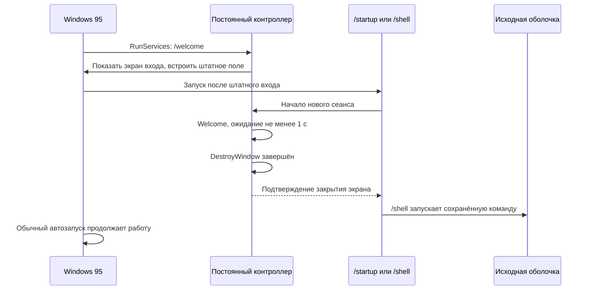

# Запуск оболочки и повторный вход Windows 95

Enable теперь подключает Welcome95 к запуску оболочки. Перед первым изменением
сохраняются исходное значение `[boot] shell` и факт его отсутствия, параметры
оболочки и владелец установки в `HKLM\Software\Welcome95\Startup`.
Дополнительно рядом с EXE создаётся **новый** файл `W95xxxx.BAK` с текстом
`[boot]` / `shell=...`, читаемый из DOS. Старые файлы не перезаписываются.
Длинный путь к EXE и его короткий путь 8.3 распознаются как одна установка,
включая запуск из папки с пробелами. Файл сбрасывается на диск, а запись резервной копии — в реестр до изменения shell.

Изменяются только `[boot] shell` в SYSTEM.INI и значения `Welcome95` в трёх
разделах HKLM `Software\Microsoft\Windows\CurrentVersion`:

| Раздел / настройка | Команда | Назначение |
| --- | --- | --- |
| RunServices | `/welcome` | Постоянный контроллер и первоначальный экран входа |
| RunOnce | `/startup` | Синхронная задержка обычного пользовательского автозапуска |
| SYSTEM.INI `[boot] shell` | короткий путь EXE + `/shell` | Запуск сохранённой оболочки после закрытия экрана |
| Run | `/session-ready` | Обычный процесс текущего сеанса для уведомления о logoff |

RunOnce считается расходуемой записью: её отсутствие после запуска не означает
Disable. Она восстанавливается для следующего входа. Другие Run/RunOnce, службы,
папки автозагрузки и параметры исходной оболочки не удаляются и не переписываются.
Порядок других заданий RunOnce остаётся у Windows. Системные RunServices не
задерживаются. Новая схема начинает действовать после Enable и перезагрузки.

Поле пароля и проверка остаются у Windows. Нажатие стрелки не сигнализирует
готовность сеанса. Готовность подтверждает запуск посредника самой ОС; как и
раньше, отмена входа Windows 95 может открыть сеанс без проверки пароля.
Welcome95 не добавляет системе новую границу безопасности.

Контроллер динамически регистрируется через Win9x RegisterServiceProcess,
поэтому переживает выход пользователя. Обычный `/session-ready` получает
уведомление завершения сеанса и сообщает его контроллеру перед собственным
выходом. При подтверждённом logoff создаётся новый экран и сбрасываются прежние
готовность/подтверждение, выбранный профиль и однократная попытка пустого входа.
Профили считываются заново.

При уведомлении без причины контроллер остаётся скрытым и освобождает шрифты.
Он ждёт нового штатного диалога либо нового запуска посредника, затем показывает
приветствие. Отсутствие причины само по себе не считается успешным новым входом.
Известное выключение из собственного окна завершается штатным выходом процесса;
при неоднозначном системном завершении зарегистрированный контроллер заканчивает
работу вместе с Windows, уже освободив временные шрифты. Отмена завершения во
время входа сохраняет экран и настоящее поле, а не оставляет пустой рабочий стол.

Если контроллер не отвечает, ожидание ограничено; посредник освобождает запуск
сохранённой оболочки. Ошибка старта самой сохранённой команды требует исправления
конфигурации. Disable восстанавливает исходное shell (включая изначально
отсутствовавший ключ), убирает только собственные значения и освобождает ожидание.
Резервные данные остаются для восстановления и уже запущенного посредника.
Чужая установка или внешняя смена shell при активной установке не перезаписывается.

## Восстановление без оболочки

1. Через F8 загрузить **Command prompt only**.
2. Найти рядом с Welcome95 файл `W95xxxx.BAK`, созданный при последнем Enable.
   Его путь также хранится в `HKLM\Software\Welcome95\Startup`, `RecoveryFile`.
3. В `EDIT C:\WINDOWS\SYSTEM.INI` восстановить **только** строку `shell=` в
   разделе `[boot]` по резервному файлу. Не заменять весь SYSTEM.INI этим файлом.
   Если прежде использовался Explorer95 или другая оболочка, сохранить её путь
   и параметры; `Explorer.exe` — запасной вариант стандартной оболочки Windows 95.
4. Убрать только значения `Welcome95` из RunServices, Run и RunOnce через REGEDIT
   в безопасном режиме или после запуска восстановленной оболочки.
5. Перезагрузить Windows. Исправление не требует изменений PWL, паролей и профилей.

## Подтверждённые проверки и границы

Тесты используют отдельные процессы Wine, собственные HKCU-разделы, временный
SYSTEM.INI и инертную оболочку, которая только создаёт временную отметку времени.
Проверяются ожидание обоих посредников до закрытия реального окна, минимум 1 с,
новый цикл без старых сигналов, logoff, отсутствие причины, отмена выключения,
восстановление на отдельном искусственном провайдере и откат установки.
Настоящие shell, logoff, системный SYSTEM.INI и HKLM Run не запускаются/не меняются
тестами. **Порядок загрузки и выход на реальной Windows 95 ещё нужно проверить.**
